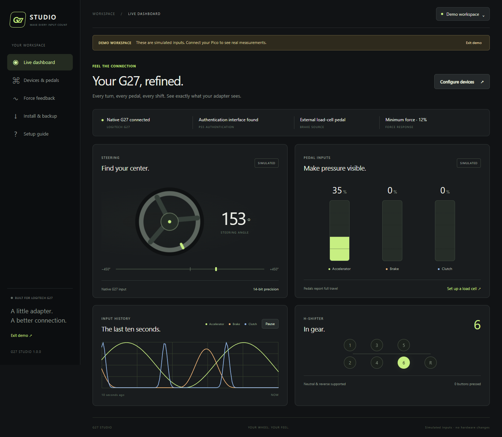
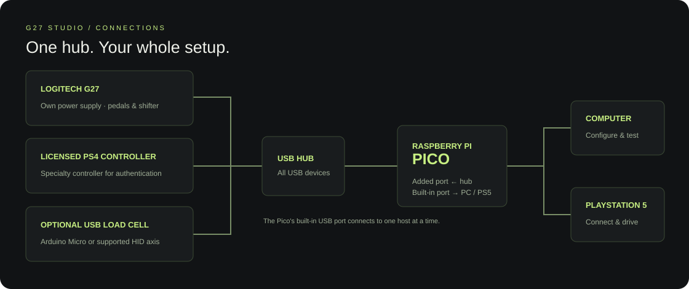
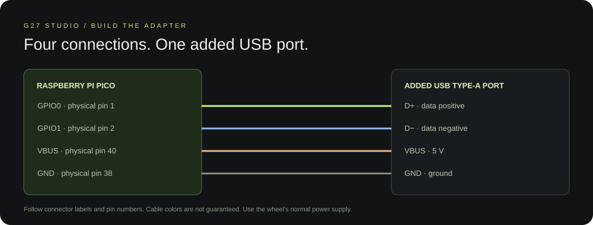
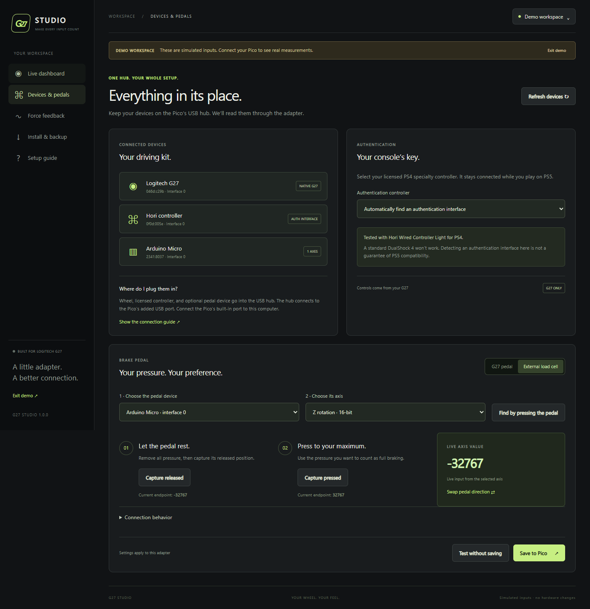
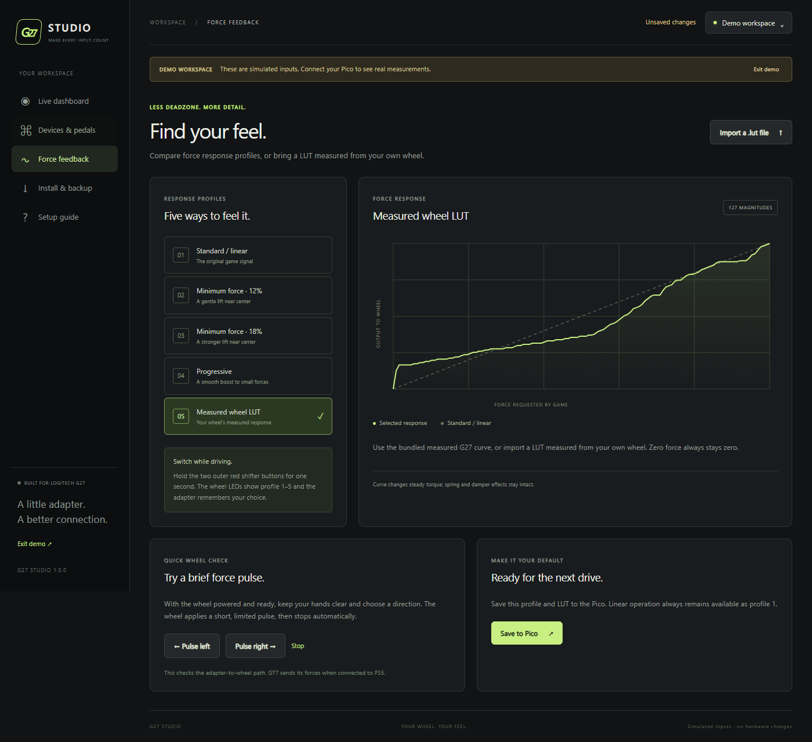

# G27 Studio

**Your wheel. Your feel.** A Raspberry Pi Pico adapter and Windows app for using
the Logitech G27 on PS5, with guided setup and configurable USB load-cell braking.

[Download releases](https://github.com/bilgon32/ps5-wheel-adapter/releases) ·
[Preview builds](https://github.com/bilgon32/ps5-wheel-adapter/actions) ·
[Developer guide](docs/development.md)

*Actual application screenshot in its labelled demo mode. Connect your Pico for
live measurements from your own devices.*

## What it does

- Native G27 steering, clutch, H-shifter, and independent wheel buttons.
- PS5 authentication through a compatible licensed PS4 specialty controller.
- USB load-cell brake selection, axis discovery, and guided calibration.
- Five force-feedback profiles, including standard operation and an imported LUT.
- Live steering, pedal graphs, and gear display for testing your setup.
- Settings backup, personalized UF2 export, and Pico installation from the app.
- Wheel LED status and force-profile selection remembered across power cycles.

The adapter runs over USB; it does not use Remote Play. **G27 is the current
wheel target. Handbrakes and other wheel models are outside this release.**

## What you need

- Logitech G27 with its power supply, pedals, and shifter.
- Raspberry Pi Pico (RP2040, 2 MB flash) with an added USB host port.
- USB hub and USB data cables.
- Compatible licensed PS4 specialty controller for authentication.
- Windows 10/11 x64 for G27 Studio.
- Optional USB load-cell pedal device, such as an Arduino Micro.

**Hori Wired Controller Light for PS4 is successfully used for authentication in
our tests.** A standard DualShock 4 does not work for this purpose.

The app bundles its firmware and Python runtime. No compiler or Python
installation is needed. Its window uses Microsoft Edge WebView2; if Windows
reports that runtime missing, install it from
[Microsoft](https://developer.microsoft.com/en-us/microsoft-edge/webview2/).

## Connect your setup

The wheel, controller, and optional pedal device stay connected to the Pico’s
downstream hub. The Pico’s built-in USB port connects to **the PC for setup** or
**the PS5 for driving**.

If you are assembling an adapter, wire its added USB Type-A port as shown:

Use connector labels and physical pin numbers; cable colors are not guaranteed.
Keep the wheel on its normal power supply.

## Install, configure, drive

1. Download the Windows ZIP from **Releases**, extract the whole archive, and open
   `G27-Studio.exe` inside the extracted folder.
2. For first installation, hold the Pico’s **BOOTSEL** button while connecting
   its built-in USB port to the PC. In **Install & backup**, choose **RPI-RP2**
   and install the bundled firmware.
3. Click **Connect Pico**. Choose **Open setup mode** if the adapter currently
   appears in console mode. Firmware predating G27 Studio needs the first
   BOOTSEL installation before this option works.
4. In **Devices & pedals**, select your authentication controller and brake
   source. For a USB load cell, choose its device, press it to identify the axis,
   and capture released and pressed positions if needed. The original G27 brake
   needs no additional configuration.
5. Check your inputs on **Live dashboard**. Choose a profile or import your
   measured `.lut` under **Force feedback**. **Test without saving** lets you
   check settings before keeping them.
6. Choose **Save & switch to console**, then move the Pico’s built-in USB cable
   to the PS5. Keep the wheel, controller, and pedals on the hub.

You can also export a personalized `.uf2` containing firmware and your settings,
or a small settings backup. Future configuration changes do not require building
source code.

## While driving

- **PS button:** press the two middle red shifter buttons together.
- **Change force profile:** hold the two outer red shifter buttons for one second.
- **Clutch in GT7:** use manual transmission and a car that supports a clutch.

| Wheel LED indication | Meaning |
| --- | --- |
| Bar fills from one to five segments | Native G27 ready or authentication completed |
| One to five segments flash | Selected force profile: linear, 12%, 18%, progressive, measured LUT |
| Two outer segments blink slowly | Authentication controller missing |
| All segments blink rapidly | Selected external brake missing or not reporting |

Status patterns temporarily take priority over the game’s RPM decoration.

An imported LUT replaces profile 5. Standard / linear always stays available.
The app’s brief force pulse tests the adapter-to-wheel path; GT7 supplies game
forces when the Pico is connected to PS5. The app’s curve graph previews the
mapping, not a physical torque measurement.

## Compatibility and help

The existing G27 console bridge, clutch, shifter, external Arduino brake, and
force feedback have been tested with GT7 on PS5. The new PC setup workflow needs
validation on the connected Pico before this preview becomes a stable release.

USB pedal support requires a readable absolute HID axis in reports up to 64
bytes. The app shows the axes it can interpret; it cannot add proprietary device
drivers. Licensed controller compatibility still depends on the controller and
console, even when its authentication interface is detected.

For connection problems, check the G27 power supply, use a USB data cable, and
try another hub. The app’s **Setup guide** includes wiring, installation, and
troubleshooting. Report problems in
[Issues](https://github.com/bilgon32/ps5-wheel-adapter/issues).

## Starting point and credit

[Jan Fedor’s wheel-adapter](https://github.com/jfedor2/wheel-adapter) provided the
original adapter design, USB bridge, and PS5 authentication that made this
project possible. G27 Studio expands that starting point toward native G27
support, configurable devices, measured force response, and accessible desktop
setup. The original history and credit remain preserved.

Upstream has no project-wide license; this fork does not relicense its code.
See [credits and dependency notices](docs/credits.md).
